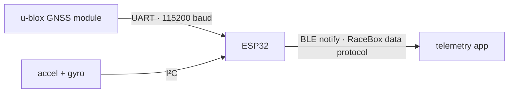
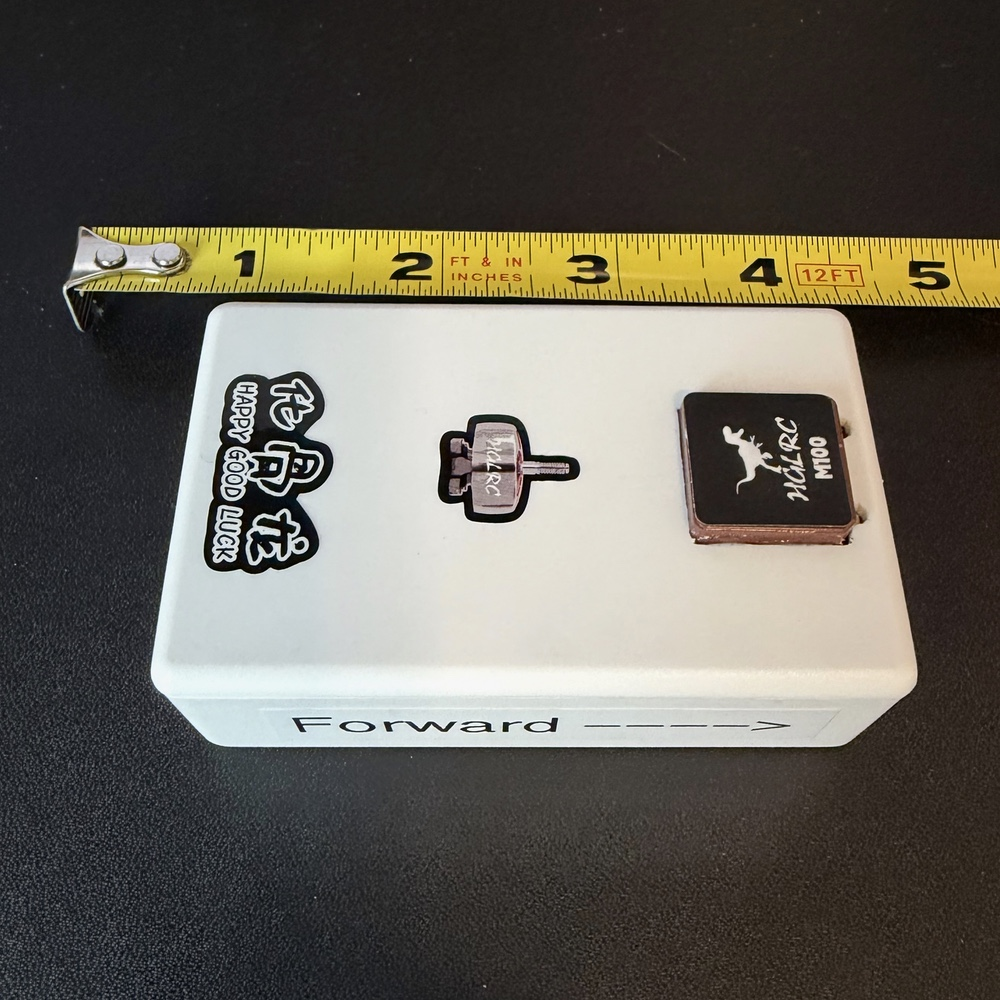
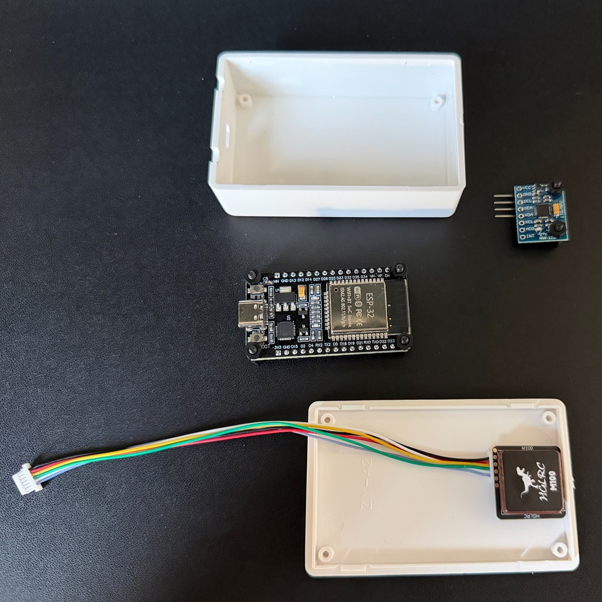
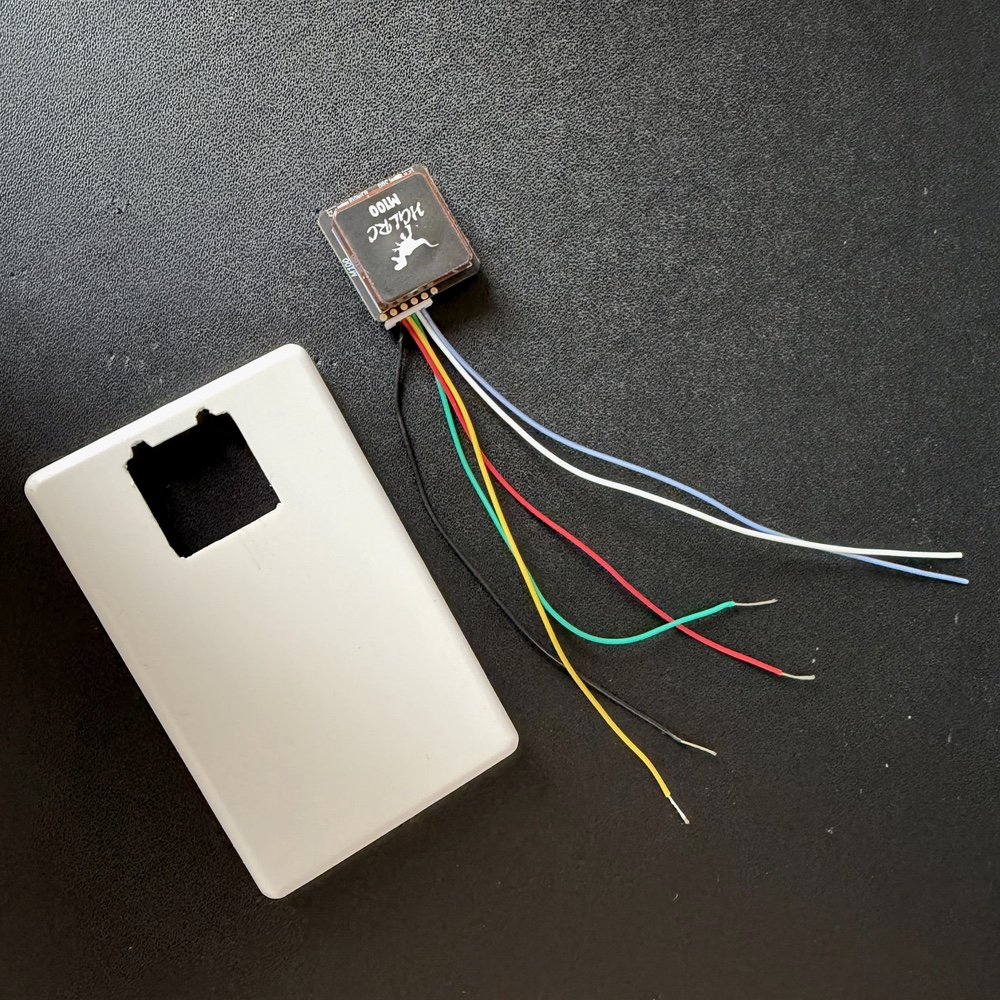
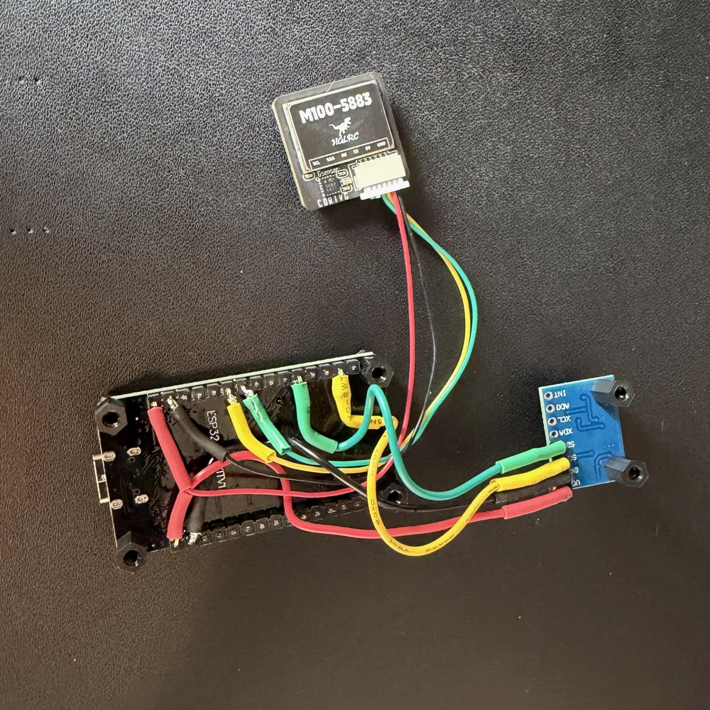
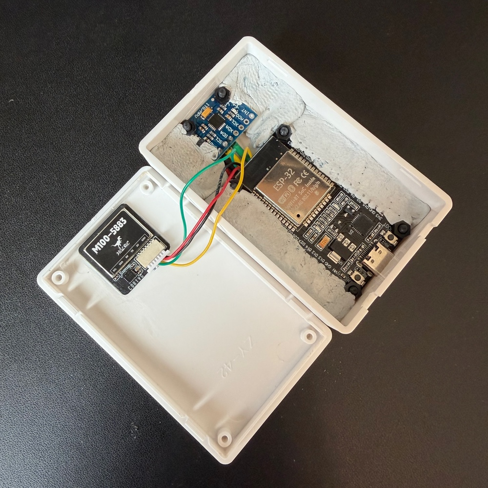
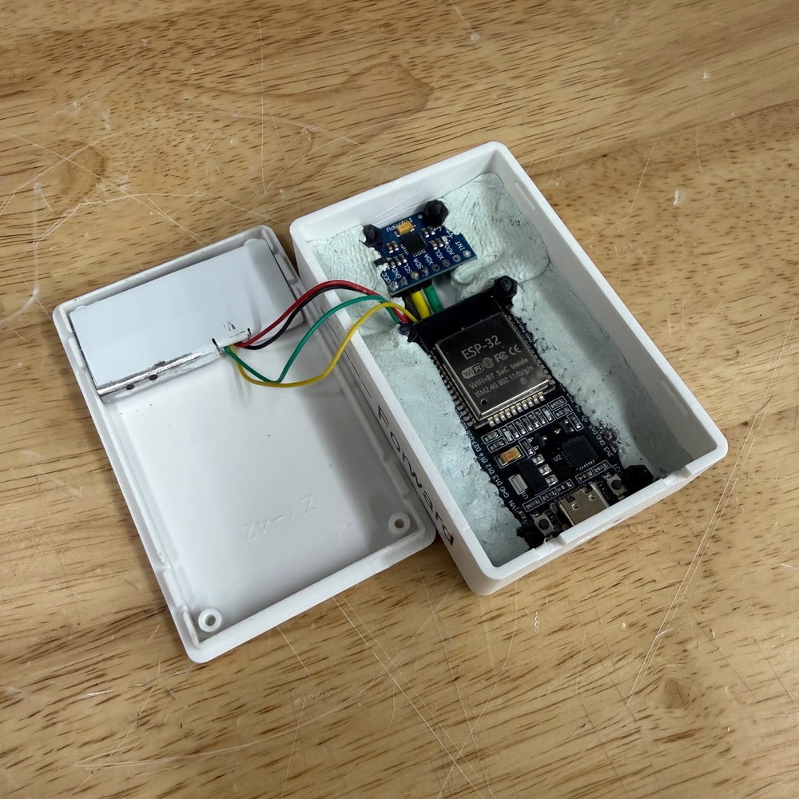
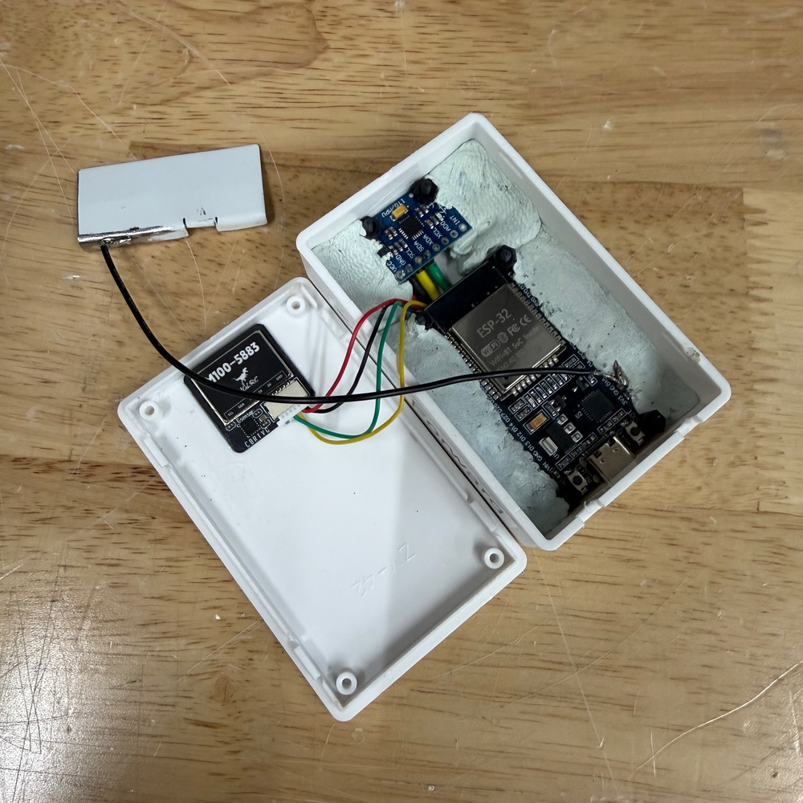
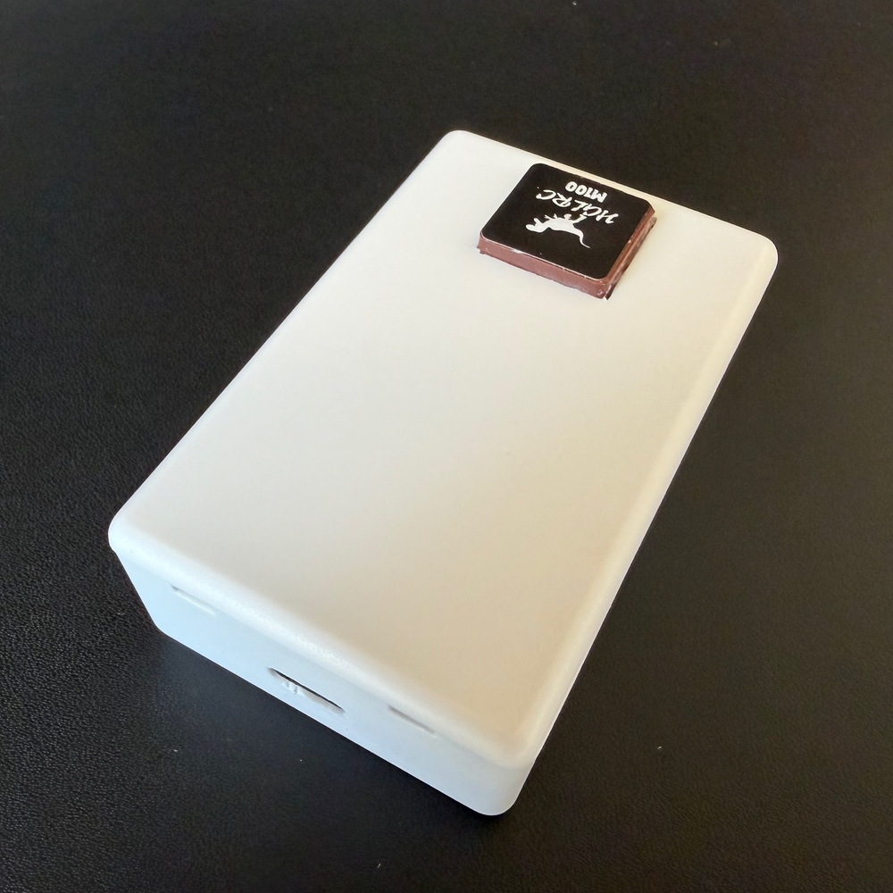
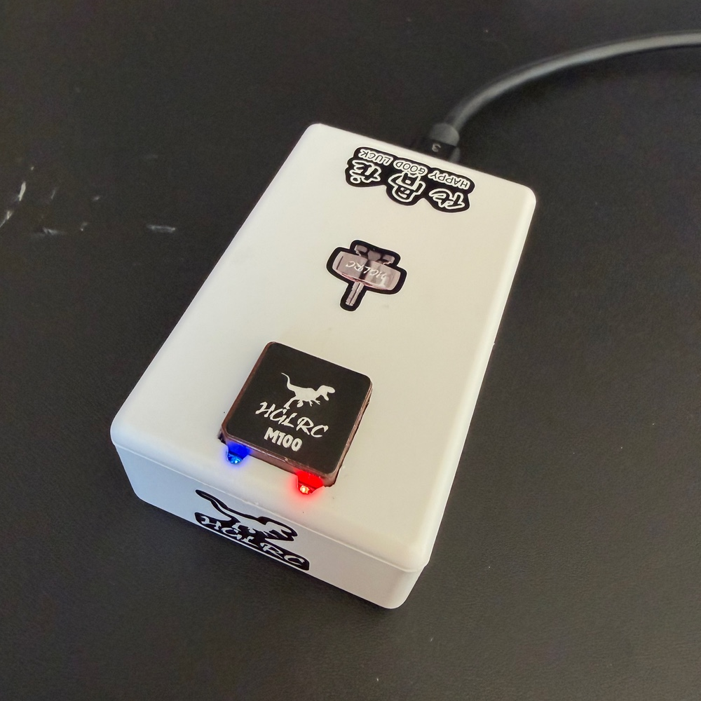

# Building the ESP32 device

This is the simple, always-plugged-in build: an ESP32 dev board, a GNSS module, and an IMU module, powered over USB. It's the best bang for the buck. It's an easy build, it's cheap, and it gives rock-solid performance at 20Hz (GPS+Galileo) or 25Hz (one constellation).

This page covers the hardware. For the software side, see [Building and flashing](building.md).

> [!NOTE]
> The hardware is unchanged from Gnimu Classic's ESP32 build. If you already have one, see [Migrating from Classic](migrating-from-classic.md).

---

## What it does

- Reads a live [**GNSS fix**](https://en.wikipedia.org/wiki/Satellite_navigation) (position, altitude, speed, heading, accuracy, fix status, satellite count) from a u-blox GNSS receiver.
- Reads **acceleration and rotation** from a 6-axis [**IMU**](https://en.wikipedia.org/wiki/Inertial_measurement_unit) at 100Hz, levels it and removes gyro bias with a calibration learned while stationary, and smooths it.
- Packs the GNSS and IMU data into a **RaceBox Data Message** and streams it over **BLE** to a compatible telemetry app, one packet per GNSS update.
- Advertises a BLE **Device Information Service** (model, serial, firmware, hardware, manufacturer) so apps can identify and pair with it.
- Reports what it's doing over **USB serial**: a boot log, an on-demand diagnostics report, and an optional 1Hz status line.

---

## Hardware

<table>
  <tr>
    <th width="28%" align="left">Part</th>
    <th align="left">Notes</th>
  </tr>
  <tr>
    <td><a href="https://www.amazon.com/dp/B0DF2YJSHN"><strong>ESP32 dev board</strong></a></td>
    <td>Developed on an AITRIP ESP32-WROOM-32 Development Board.</td>
  </tr>
  <tr>
    <td><a href="https://www.amazon.com/dp/B0CB5N8RQ8"><strong>u-blox GNSS module</strong></a></td>
    <td>A u-blox <a href="https://www.u-blox.com/en/product/max-m10-series">M10-class</a> GNSS receiver. Reference unit: <a href="https://www.hglrc.com/products/m100-5883-gps">HGLRC M100-5883</a>. Other u-blox modules supported by the SparkFun library should work.</td>
  </tr>
  <tr>
    <td><a href="https://www.amazon.com/dp/B01DK83ZYQ"><strong>IMU module</strong></a></td>
    <td>I²C 6-axis accelerometer + gyroscope breakout. Reference unit: <a href="http://www.hiletgo.com/ProductDetail/2157948.html">HiLetgo GY-521</a> based on the <a href="https://invensense.tdk.com/products/motion-tracking/6-axis/mpu-6050/">InvenSense MPU-6050</a>.</td>
  </tr>
  <tr>
    <td><a href="https://www.amazon.com/dp/B0BQYPKRQS"><strong>Project Box</strong></a></td>
    <td>ABS plastic project case, white, 80x50x26mm. You'll need to cut holes into this box to fit your specific board and component layout (see images below).</td>
  </tr>
  <tr>
    <td><a href="https://www.amazon.com/dp/B0FPMC9917"><strong>Nylon M2.5 hex standoffs</strong></a></td>
    <td>Nylon hex standoffs, washers, nuts, screws, to help with positioning the components within the project box.</td>
  </tr>
</table>

Before you rely on the GNSS module at 20Hz or more, read the notes on GNSS modules in the [README](../README.md#three-notes-about-gnss-modules). The HGLRC modules need a one-time change to hold those rates.

### Wiring

**GNSS module → ESP32 (UART, Serial2)**

| GNSS pin | ESP32 pin |
|----------|-----------|
| TX       | GPIO16 (RX2) |
| RX       | GPIO17 (TX2) |
| VCC      | 3V3 |
| GND      | GND |

**IMU module → ESP32 (I²C)**

| IMU pin | ESP32 pin |
|-------------|-----------|
| SDA         | GPIO21 (default I²C SDA) |
| SCL         | GPIO22 (default I²C SCL) |
| VCC         | VIN (5V pin) |
| GND         | GND |

**Status LED:** the dev board's onboard LED (GPIO2).

> The pin assignments are in [`code/Gnimu/src/platform/esp32/BoardConfig.h`](../code/Gnimu/src/platform/esp32/BoardConfig.h), if you need to route something differently.

---

## Build gallery

Photos of the reference build, from loose components to the finished, enclosed unit. Several shots show an **RF shield** fitted over the electronics. It's a hardware counterpart to the firmware's reduced BLE power, further isolating the GNSS receiver from radio noise (see [A note on BLE power and GNSS lock](#a-note-on-ble-power-and-gnss-lock)).

   
  The completed device, decorated with the stickers that came with the GNSS module and an indicator of which end points forward (for Gyro/Accelerometer). &nbsp;

<table>
  <tr>
    <td align="center" valign="top" width="50%">
       
      Components and enclosure prior to assembly. &nbsp;
    </td>
    <td align="center" valign="top" width="50%">
       
      GNSS module with mounting hole in the lid. &nbsp;
    </td>
  </tr>
  <tr>
    <td align="center" valign="top" width="50%">
       
      Components wired together, using header pins underneath the ESP32 board. Extra unused pins were clipped off. &nbsp;
    </td>
    <td align="center" valign="top" width="50%">
       
      Assembled, using hardening epoxy putty to firmly affix the components.
    </td>
  </tr>
  <tr>
    <td align="center" valign="top" width="50%">
       
      RF shield test fit, not yet grounded or affixed. &nbsp;
    </td>
    <td align="center" valign="top" width="50%">
       
      RF shield grounded; I used two-sided tape to mount the shield. &nbsp;
    </td>
  </tr>
  <tr>
    <td align="center" valign="top" width="50%">
       
      Enclosure closed up, ready to test (before stickers!). &nbsp;
    </td>
    <td align="center" valign="top" width="50%">
       
      Connected to power, LEDs lit up. &nbsp;
    </td>
  </tr>
</table>

---

## Flashing

Follow [Building and flashing](building.md), selecting **ESP32 Dev Module** as the board. There is nothing to edit first.

Open the Serial Monitor at **115200 baud** for the first boot. The [boot log](console.md#the-boot-log) reports every step, and on a new GNSS module it shows the receiver's settings being written and saved.

---

## Usage

1. Power the assembled device over USB and give the GNSS module time to acquire a fix. The onboard LED blinks slowly while no app is connected.
2. In your telemetry app, scan for and connect to the device. It advertises as `Gnimu-RB` followed by a 10-digit ID, which the boot log prints as `Device ID`. If your app doesn't list it, see [`kBleNamePrefix`](configuration.md#ble).
3. On connect, the LED goes solid and the device begins streaming data packets.
4. Leave it parked and still for the first minute or two so it can calibrate itself to its mounting. See the mounting note in the [README](../README.md#a-note-about-mounting-and-self-calibration).
5. Optional: keep a serial monitor open and type `L` and Enter for a 1Hz status line. See [Console and diagnostics](console.md).

### Status LED

The dev board's LED is a single color, so it shows the pattern only.

| Pattern | Meaning |
|---|---|
| Slow blink, 1 s on, 1 s off | Running, waiting for an app to connect. |
| Solid | An app is connected. |
| Rapid blink | Fault. Start-up couldn't finish; check the boot log. |

### A note on BLE power and GNSS lock

GNSS reception is sensitive to nearby RF noise. On compact builds, the ESP32's BLE radio can desensitize the GNSS receiver. Keeping `kBleTxPowerDbm` at a low level (the default is `-12`, the minimum) keeps the radio quiet. The client is usually close by, so high power isn't needed, and it can dramatically improve fix quality, including indoors.

The **RF shield** shown in the [build gallery](#build-gallery) is the hardware counterpart to this: a grounded metal enclosure over the GNSS module that physically blocks radio noise from reaching the GNSS receiver. The two measures stack. Lowering the BLE power quiets the source, while the shield blocks whatever remains. Either helps on its own; together they give the most reliable lock.

When the BLE power level was left at +9dBm on my ESP32 board, the device had significantly worse lock quality, sometimes not getting a fix at all (especially indoors).

With the BLE power level set to -12dBm, I have seen simultaneous lock on as many as 20 satellites with horizontal accuracy (hAcc) as low as 220mm and [pDOP](https://en.wikipedia.org/wiki/Dilution_of_precision) values under 2 (really good for a cheap consumer-grade GNSS module).

---

## Troubleshooting

The boot log is the first place to look. Every step reports ✅ or ❌.

| Symptom | Things to check |
|---------|-----------------|
| `GNSS not detected at any standard baud rate` | UART wiring (note the TX↔RX crossover) and module power. The firmware tries every standard baud rate before giving up. |
| `GNSS detected but sending no data` | The module's power supply. |
| `IMU: MPU-6050 detected ❌`, then `IMU: continuing without it` | I²C wiring (SDA/SCL) and IMU power. The device still streams GNSS data; the IMU fields read zero. |
| LED blinking rapidly | A fault. The boot log says which; the console still answers `D` and `V`. Power-cycle after fixing the cause. |
| Few or no satellites | Move outdoors or near a window; keep `kBleTxPowerDbm` low; give it a cold-start minute. |
| The GNSS rate sags as the satellite count climbs | The module is running at its stock clock. See the notes on GNSS modules in the [README](../README.md#three-notes-about-gnss-modules). |
| App won't connect | Make sure no other client is already connected, and that you're selecting the name the boot log shows. |
| An axis reads backwards in the app | Adjust the mounting orientation in [Configuration](configuration.md#mounting-orientation). |
| Build fails with a `static_assert` message | Read the message. It names the offending setting and the allowed range. |
