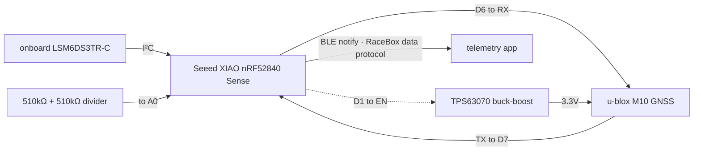
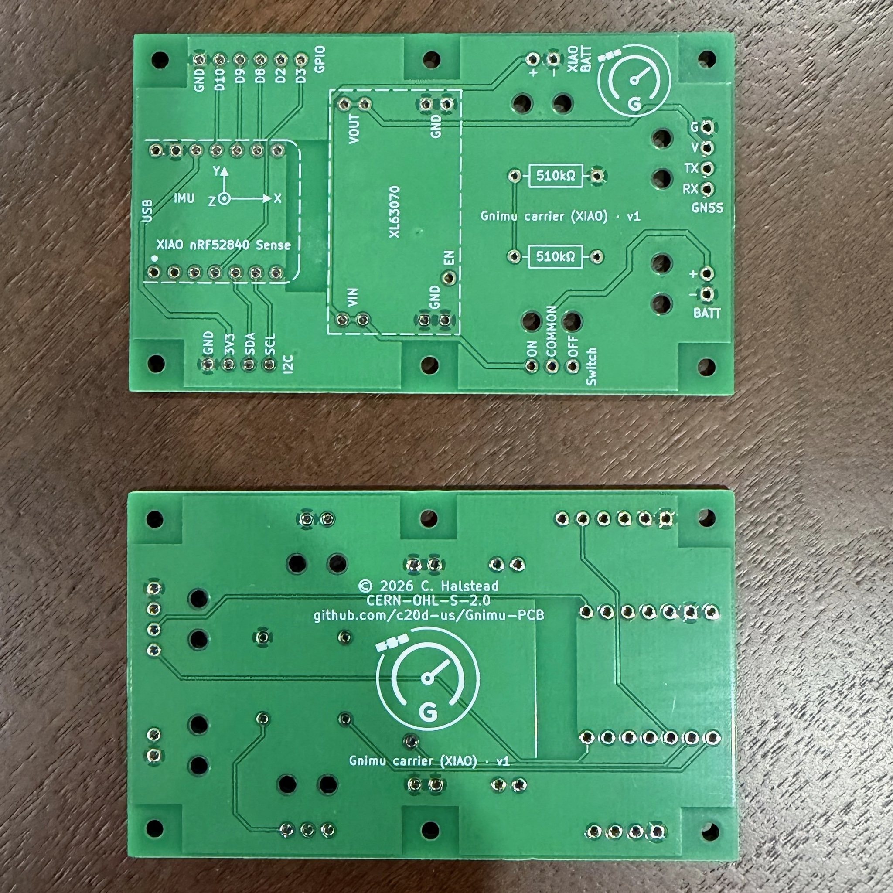
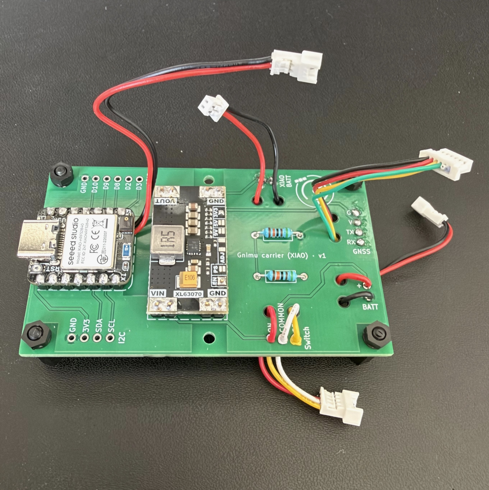
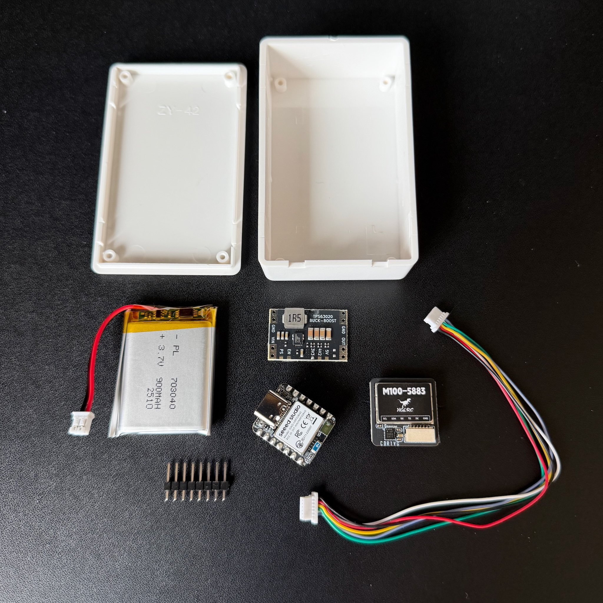
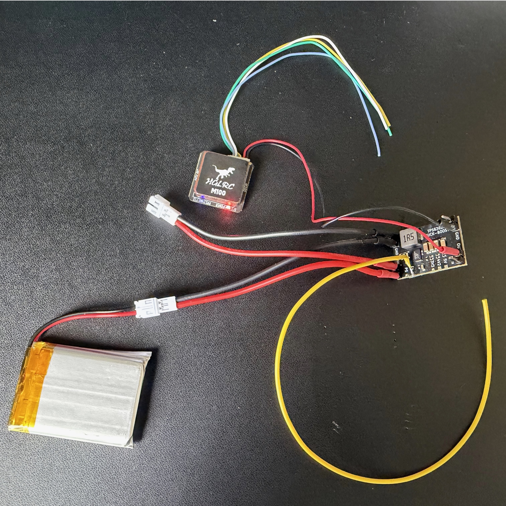
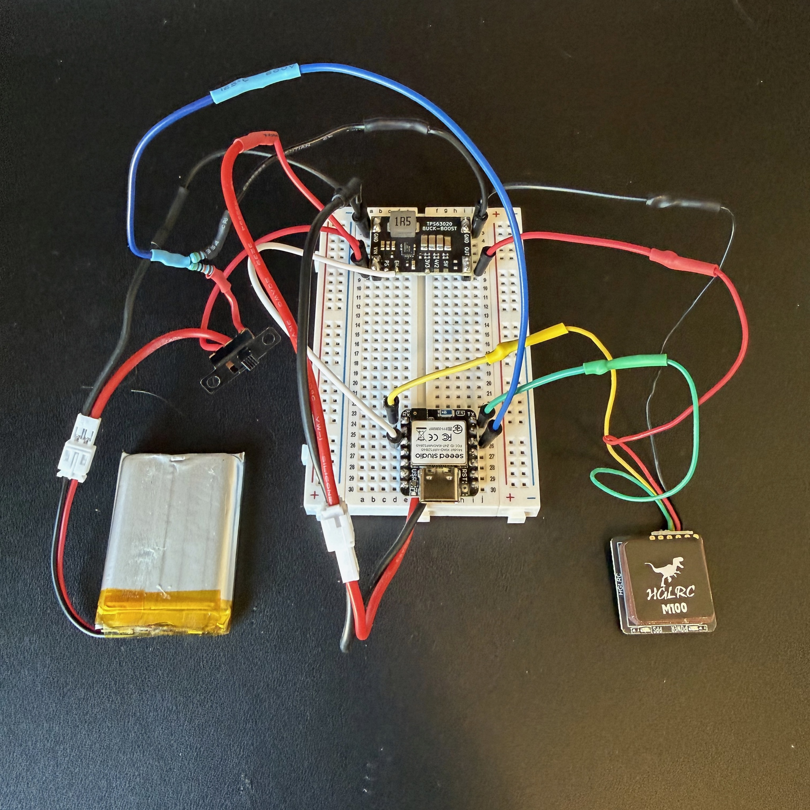
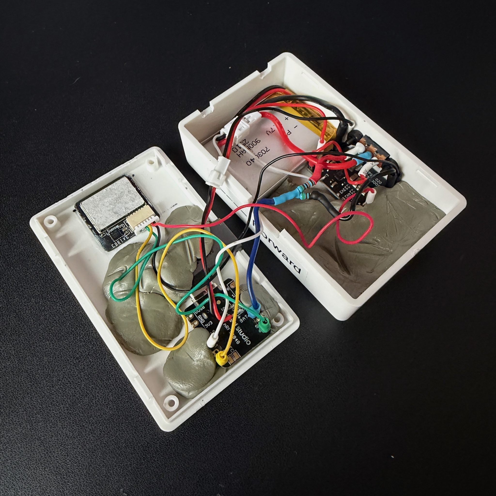
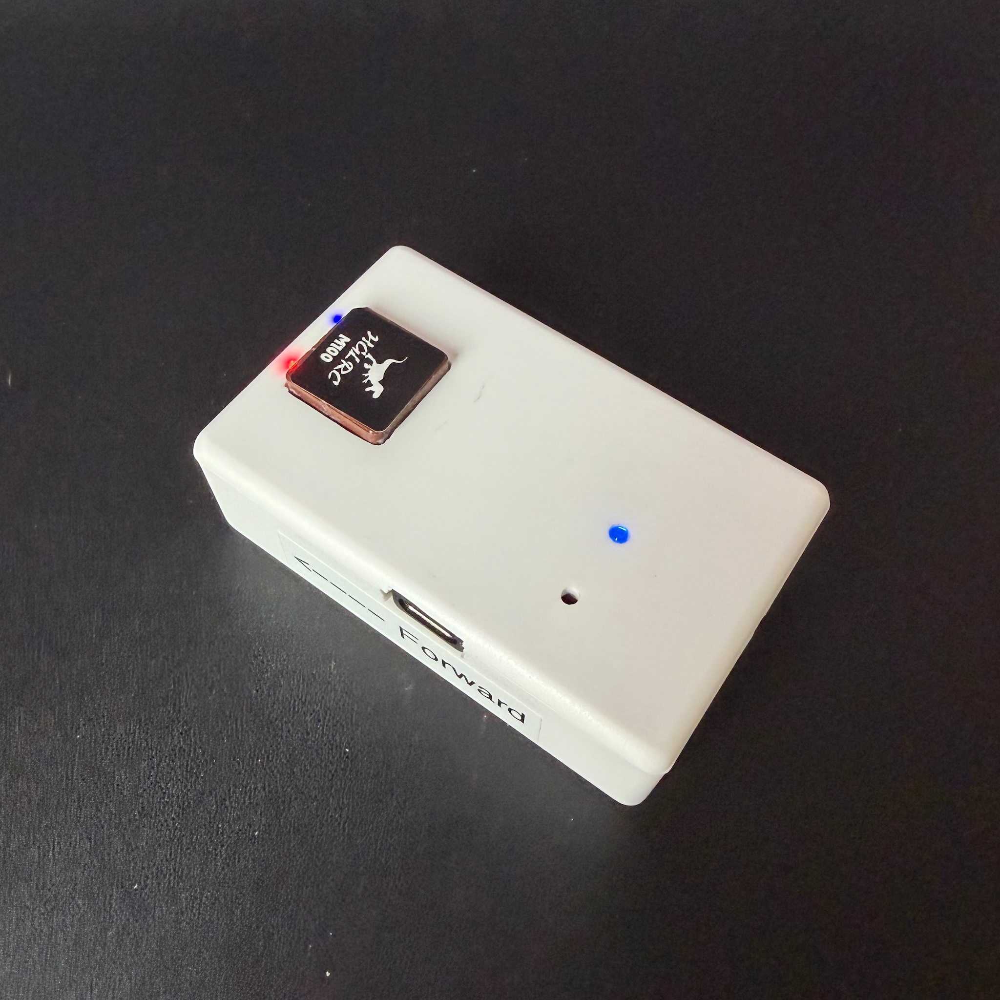
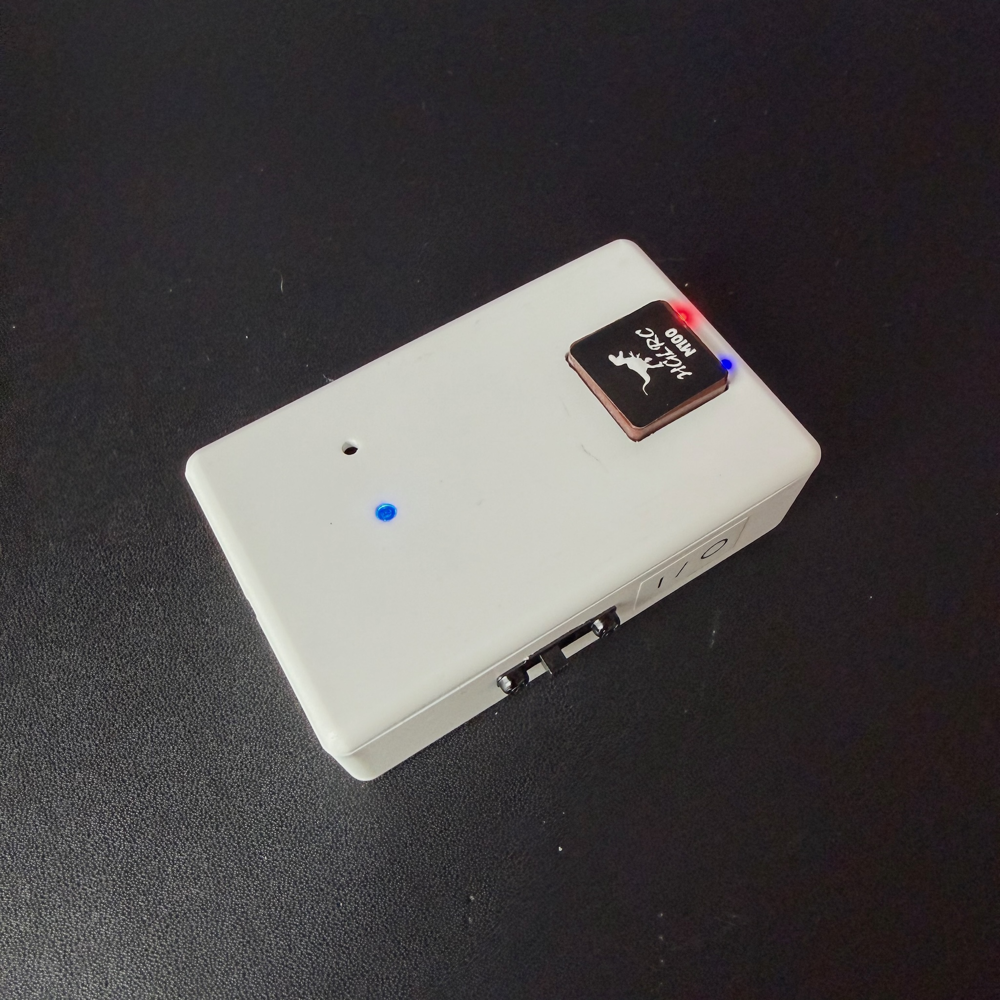

# Building the XIAO nRF52840 device

This is the portable, battery-powered build: a Seeed XIAO nRF52840 Sense, a GNSS module, a small regulator, a LiPo cell, and a slide switch. The XIAO brings its own IMU, battery charger, and RGB LED, so there is very little else to add.

There are two ways to put it together:

- **On the Gnimu carrier PCB** (recommended). A small through-hole board that the XIAO and the regulator module solder onto, with labelled connections for everything else.
- **Hand-wired**, point to point, with the same parts and the same connections.

Both produce the same device and run the same firmware with no changes.

This page covers the hardware. For the software side, see [Building and flashing](building.md).

> [!NOTE]
> If you have a device built from the Gnimu Classic nRF52840 instructions, two connections differ from this guide. See [Migrating from Classic](migrating-from-classic.md).

---

## What it does

- Reads a live [**GNSS fix**](https://en.wikipedia.org/wiki/Satellite_navigation) (position, altitude, speed, heading, accuracy, fix status, satellite count) from a u-blox GNSS receiver.
- Reads **acceleration and rotation** from the XIAO's **onboard 6-axis IMU** (LSM6DS3TR-C) at 100Hz, levels it and removes gyro bias with a calibration learned while stationary, and smooths it.
- Packs the GNSS and IMU data into a **RaceBox Data Message** and streams it over **BLE** to a compatible telemetry app, one packet per GNSS update.
- **Runs on battery.** Reads its own LiPo voltage, reports state of charge and charging status in the RaceBox protocol's battery byte, and enforces a **firmware low-voltage cutoff** to protect the cell.
- Advertises a BLE **Device Information Service** and a **Battery Service**, so apps can identify it, pair with it, and display the cell's state.
- Drives an **RGB status LED** for advertising, connected, low battery, charging, and faults.
- Reports what it's doing over **USB serial**: a boot log, an on-demand diagnostics report, and an optional 1Hz status line.



---

## Hardware

These parts are the same whichever way you build it.

<table>
  <tr>
    <th width="30%" align="left">Part</th>
    <th align="left">Notes</th>
  </tr>
  <tr>
    <td><a href="https://www.amazon.com/dp/B0DRNTLCWC"><strong>Seeed XIAO nRF52840 Sense</strong></a></td>
    <td>The heart of the build: nRF52840 BLE SoC, onboard 6-axis LSM6DS3TR-C IMU, and onboard LiPo charging, in a 21×18 mm footprint. It must be the <strong>Sense</strong> version; the plain XIAO nRF52840 has no IMU. More details at <a href="https://wiki.seeedstudio.com/XIAO_BLE/">the Seeed Studio Wiki</a>.</td>
  </tr>
  <tr>
    <td><a href="https://www.amazon.com/dp/B0CB5N8RQ8"><strong>u-blox GNSS module</strong></a></td>
    <td>A u-blox M10-class GNSS receiver. Reference unit: <a href="https://www.hglrc.com/products/m100-5883-gps">HGLRC M100-5883</a>. The compass pins are unused.</td>
  </tr>
  <tr>
    <td><a href="https://www.amazon.com/EC-Buying-Buck-Boost-Microcontroller-TPS63070/dp/B0G3FSY393"><strong>TPS63070 buck-boost regulator module</strong></a></td>
    <td>Supplies the GNSS a stable 3.3V rail across the full LiPo voltage range. It powers only the GNSS; the XIAO runs directly from the battery. Its EN pin goes to the XIAO, which uses it to switch the GNSS on and off. Use the <strong>3.3V</strong> version. The GNSS module accepts 3.3V or 5V, but it regulates down to 3.3V internally, so feeding it 3.3V is the more efficient choice. The linked module ships set to 3.3V; the same module may also be available pre-set to 5V or 9V, and <strong>9V will destroy the GNSS module</strong>. Its <strong>PS</strong> solder jumper comes open; leave it that way. The carrier PCB is laid out for the XL63070 module.</td>
  </tr>
  <tr>
    <td><a href="https://www.amazon.com/dp/B0DPZVBKMY"><strong>3.7V LiPo battery</strong></a></td>
    <td>Flat pouch cell, 1000mAh, with a built-in protection circuit (overcharge, over-discharge, overcurrent, short circuit). The firmware's low-voltage cutoff is an additional protection against over-discharge.</td>
  </tr>
  <tr>
    <td><a href="https://www.amazon.com/dp/B0BWMS64PR"><strong>Latching 1P2T slide switch</strong></a></td>
    <td>Inline on the battery's positive lead for a full power disconnect. Slide it off to store the unit between uses. It must be on to charge the battery. Its second position feeds the switch-sense divider.</td>
  </tr>
  <tr>
    <td><a href="https://www.amazon.com/dp/B08QRGJF5G"><strong>Two 510kΩ resistors</strong></a></td>
    <td>The voltage divider that tells the firmware which way the switch is set.</td>
  </tr>
  <tr>
    <td><strong><a href="https://www.amazon.com/dp/B08SC3F658">JST PH2.0 leads</a><br><br><a href="https://www.amazon.com/dp/B0B2D8R9CX">JST 1.25 leads</a></strong></td>
    <td>Connector leads for the LiPo, the switch, and the GNSS module.</td>
  </tr>
  <tr>
    <td><a href="https://www.amazon.com/dp/B0BQYPKRQS"><strong>Project box</strong></a></td>
    <td>ABS plastic enclosure. Cut openings for the GNSS antenna patch, the GNSS and XIAO LEDs, the XIAO reset button, and the USB-C connector.</td>
  </tr>
</table>

Before you rely on the GNSS module at 20Hz or more, read the notes on GNSS modules in the [README](../README.md#three-notes-about-gnss-modules). The HGLRC modules need a one-time change to hold those rates.

### How it's connected

The connections are the same on the carrier PCB and in a hand-wired build.

| XIAO pin | Goes to | Purpose |
|---|---|---|
| **D6** (Serial1 TX) | GNSS **RX** | UART, TX↔RX crossover |
| **D7** (Serial1 RX) | GNSS **TX** | UART, TX↔RX crossover |
| **D1** | Regulator **EN** | GNSS power control. The module's own pull-up keeps it on; the XIAO pulls it low to switch the GNSS off. |
| **D0 / A0** | Switch-sense divider tap | Reads about 2V with the switch off and about 0V with it on. |
| **BAT+ / BAT−** pads | Switch and battery | The XIAO runs from, and charges, the LiPo. |

The power wiring:

```
        (+) ─ SW common
               │
  LiPo         ├─[ SW ON  ]──┬──────────────────────► XIAO BAT+
  3.7V         │             └──────────────────────► regulator VIN
               └─[ SW OFF ]──[ 510kΩ ]──┬───────────► XIAO D0/A0
                                        └─[ 510kΩ ]─► GND
        (–) ────────────────────────────────────────► XIAO BAT−, regulator GND, GNSS GND

  regulator VOUT (3.3V) ────────────────────────────► GNSS VCC
```

- The GNSS **SDA / SCL** (compass) pins are left unconnected.
- The **IMU**, the **RGB LED**, the **battery sense**, and the **charger** are all onboard the XIAO and need no wiring.

---

## Building it on the carrier PCB

The carrier's design files and fabrication outputs are in the [Gnimu-PCB](https://github.com/c20d-us/Gnimu-PCB) repository, under [`boards/gnimu/`](https://github.com/c20d-us/Gnimu-PCB/tree/main/boards/gnimu), one folder per board revision. Each is a KiCad project, and a revision that has been sent out for fabrication also has a `fabrication/` folder with gerbers ready to send to a board house. Use the latest revision that has one. Revision v1.1 differs from v1 only in its larger mounting holes (2.7mm, up from 2.2mm) and a printed reminder of the regulator's settings, `PS open · 3V3`; the two are wired identically.

<table>
  <tr>
    <td align="center" valign="top" width="50%">
      <br>
      <sub>The bare carrier (revision v1), front and back.</sub><br>&nbsp;
    </td>
    <td align="center" valign="top" width="50%">
      <br>
      <sub>Loaded: the XIAO, the XL63070 regulator, the two resistors, and leads<br>for the GNSS, battery, XIAO battery pads and switch.</sub><br>&nbsp;
    </td>
  </tr>
</table>

Everything on it is through-hole, and every position is labelled on the silkscreen. You solder on:

| Silkscreen | Part |
|---|---|
| **XIAO nRF52840 Sense** | The XIAO, by its 14 edge pins, with its USB connector at the board edge marked **USB**. |
| **XL63070** | The XL63070 (TPS63070) buck-boost module, the 3.3V version, with its PS solder jumper left open as supplied. |
| **510kΩ** (two positions) | The two 510kΩ resistors. |

and connect the rest to its labelled pads:

| Silkscreen | Pads | Connects to |
|---|---|---|
| **GNSS** | G · V · TX · RX | The GNSS module: ground, 3.3V power, and the module's own TX and RX pins. |
| **BATT** | + · − | The LiPo. |
| **Switch** | ON · COMMON · OFF | The slide switch: its common terminal to COMMON, its two throws to ON and OFF. |
| **XIAO BATT** | + · − | The battery pads on the underside of the XIAO. |
| **I2C** | GND · 3V3 · SDA · SCL | Spare. Not used by the firmware. |
| **GPIO** | GND · D10 · D9 · D8 · D2 · D3 | Spare. Not used by the firmware. |

The **TX** and **RX** pads are named for the GNSS module's pins: wire the module's TX to TX and its RX to RX. The crossover to the XIAO is done on the board.

The XIAO's battery pads are on its underside and aren't part of its edge pins, so **XIAO BATT** carries the switched battery to them with two short wires.

The **IMU** axes printed beside the XIAO show how the device must sit in the car: the **X** arrow points to the front of the car and the **Y** arrow to its left, with the component side of the board facing up. That puts the XIAO's USB connector toward the rear.

---

## Building it hand-wired

Without the carrier, make the connections in [How it's connected](#how-its-connected) point to point:

1. Wire the LiPo's positive lead to the switch's common terminal.
2. From the switch's **on** throw, run to both the XIAO's **BAT+** pad and the regulator's **VIN**.
3. From the switch's **off** throw, run through one 510kΩ resistor to the XIAO's **D0/A0**, and from D0/A0 through the second 510kΩ resistor to ground.
4. Join the grounds: LiPo negative, XIAO **BAT−**, regulator GND, GNSS GND.
5. Wire the regulator's **VOUT** to the GNSS **VCC**, and its **EN** to the XIAO's **D1**.
6. Wire the XIAO's **D6** to the GNSS **RX**, and **D7** to the GNSS **TX**.


## Check the regulator before connecting the GNSS

> [!WARNING]
> **Never feed the GNSS module 9V.** The regulator module can be configured for a 9V output, and may be available pre-set that way; 9V will destroy the GNSS module. Confirm the regulator's output before the GNSS is connected to it:
>
> 1. Look at the module and confirm its output setting is marked 3.3V.
> 2. Power it from the battery with the GNSS disconnected, and measure **VOUT** to **GND** with a multimeter. It should read 3.3V.
>
> The GNSS module also runs from 5V, so a regulator set to 5V won't harm it. 3.3V is still the setting to use: the module regulates down to 3.3V internally, so anything above that is lost as heat.
>
> This applies to both the carrier PCB and a hand-wired build.

---

## Build gallery

These photos are of a hand-wired build made for Gnimu Classic. The parts and layout are the same as a hand-wired build today, apart from the regulator (a TPS63020 here) and the two XIAO pins that moved.

<table>
  <tr>
    <td align="center" valign="top" width="50%">
      <br>
      <sub>Components before assembly.</sub><br>&nbsp;
    </td>
    <td align="center" valign="top" width="50%">
      <br>
      <sub>Buck-boost regulator wired to the battery and GNSS.</sub><br>&nbsp;
    </td>
  </tr>
  <tr>
    <td align="center" valign="top" width="50%">
      <br>
      <sub>Bench testing on a breadboard.</sub><br>&nbsp;
    </td>
    <td align="center" valign="top" width="50%">
      <br>
      <sub>Components wired and installed in case, held firm by hardening putty.</sub><br>&nbsp;
    </td>
  </tr>
  <tr>
    <td align="center" valign="top" width="50%">
      <br>
      <sub>The completed device, powered on and showing USB port.</sub><br>&nbsp;
    </td>
    <td align="center" valign="top" width="50%">
      <br>
      <sub>The completed device, powered on and showing slide switch.</sub><br>&nbsp;
    </td>
  </tr>
</table>

---

## Flashing

Follow [Building and flashing](building.md), selecting **Seeed XIAO nRF52840 Sense** as the board. There is nothing to edit first.

Open the Serial Monitor at **115200 baud** for the first boot. The [boot log](console.md#the-boot-log) reports every step, and on a new GNSS module it shows the receiver's settings being written and saved.

---

## Battery and power

- The XIAO runs directly off the **LiPo** and charges it over **USB-C**. The **slide switch** gives a full battery disconnect for storage.
- **Turn the switch off when you're done.** The firmware runs for as long as it has power; it doesn't go to sleep by itself.
- The firmware reads the LiPo voltage, turns it into a percentage, and sends it with the charging status in the **RaceBox protocol battery byte** and the BLE Battery Service.
- A **low-voltage cutoff** protects the cell: running on battery below the cutoff voltage for five seconds powers the device off. Plug in USB, or cycle the switch, to start it again.

### Charging

The battery charges whenever USB is connected and the switch is **on**. With the switch off, the battery is disconnected and can't charge.

A running device keeps running when you plug it in, which is convenient on the bench but means the charger never quite finishes. To charge with everything else off:

1. With USB connected, slide the switch **off**. The LED blinks amber quickly.
2. Slide it back **on**. The LED blinks green while charging, and turns solid green when the cell is full.

To go back to running, slide the switch off and on again, or unplug USB.

The thresholds are in [Configuration](configuration.md#battery), and the full set of power states is described in [Architecture](architecture.md#power-on-battery-boards).

---

## Usage

1. Charge the LiPo before using the device away from USB.
2. Mount the device level, with the XIAO's **USB connector toward the rear of the car**, slide the switch on, and give the GNSS time to acquire a fix. The LED **blinks blue** while waiting for an app.
3. The M100's own LEDs report GNSS status (see the table below).
4. In your telemetry app, scan for and connect to the device. It advertises as `Gnimu-RB` followed by a 10-digit ID, which the boot log prints as `Device ID`. If your app doesn't list it, see [`kBleNamePrefix`](configuration.md#ble).
5. On connect, the LED turns **solid blue** and the device begins streaming data packets.
6. Leave it parked and still for the first minute or two so it can calibrate itself to its mounting. See the mounting note in the [README](../README.md#a-note-about-mounting-and-self-calibration).
7. Optional: with USB connected and a serial monitor open, type `L` and Enter for a 1Hz status line. See [Console and diagnostics](console.md).

### Gnimu status LED

The XIAO's onboard RGB LED signals state:

| Color | Meaning |
|---|---|
| 🔵 Blue (slow blink) | Running, waiting for an app to connect. |
| 🔵 Blue (steady) | An app is connected. |
| 🟡 Amber (slow blink) | Low battery, warning. |
| 🔴 Red (slow blink) | Low battery, critical. |
| 🔴 Red (rapid blink) | **Fault.** Start-up couldn't finish; check the boot log. |
| 🟡 Amber (quick blink) | The switch is **off** while USB is connected. Slide it on to charge. |
| 🟢 Green (slow blink) | Charging, with everything else off. |
| 🟢 Green (steady) | Fully charged. |

A low-battery warning takes priority over the blue BLE indication.

### M100 GNSS LED indicators

These are the M100 module's own LEDs, not driven by the firmware. They're useful for judging fix status without a serial connection.

| LED | Pattern | Meaning |
|---|---|---|
| Red (power) | Solid | GNSS rail powered |
| Blue (PPS) | Fast flicker | Powered, no fix acquired yet |
| Blue (PPS) | Fast flicker with a 1Hz blink | 3D fix and time lock acquired |

### A note on BLE power and GNSS lock

GNSS reception is sensitive to nearby RF noise, and a compact build puts the BLE radio right next to the GNSS front end. Keeping the BLE transmit power low (`kBleTxPowerDbm`, default **−12dBm**) keeps the radio quiet. The client is usually close by, so high power isn't needed, and lower power can dramatically improve fix quality. Running the GNSS from its own **3.3V buck-boost rail** further reduces supply noise.

---

## Troubleshooting

The boot log is the first place to look. Every step reports ✅ or ❌.

| Symptom | Things to check |
|---|---|
| LED blinks **amber quickly** and nothing else works | The slide switch is **off** while USB is connected. Slide it on. |
| LED blinks **green** and the device doesn't appear in BLE scans | It's in charge-only mode. Slide the switch off and on again, or unplug USB, to return to running. |
| LED blinks **red rapidly** | A fault. The boot log says which; the console still answers `D` and `V`. Power-cycle after fixing the cause. |
| `GNSS not detected at any standard baud rate` | UART wiring (note the TX↔RX crossover), the 3.3V rail (measure it), and that the regulator's EN reaches D1. |
| `GNSS detected but sending no data` | The GNSS rail. A module that is only partly powered can answer without producing fixes. |
| `IMU: LSM6DS3TR-C detected ❌` | Confirm that you have a **Sense** XIAO; the plain XIAO has no IMU. The device still streams GNSS data, with the IMU fields reading zero. |
| The device restarts or misbehaves when the switch is moved | Confirm the switch sense is on **D0/A0** and the regulator EN on **D1**. A Classic-wired device needs the Classic pinout selected; see [Migrating from Classic](migrating-from-classic.md). |
| Few or no satellites | Move outdoors or near a window; keep the BLE transmit power low; give it a cold-start minute. |
| The GNSS rate sags as the satellite count climbs | The module is running at its stock clock. See the notes on GNSS modules in the [README](../README.md#three-notes-about-gnss-modules). |
| App won't connect | Make sure no other client already holds the connection, and that you're selecting the name the boot log shows. |
| `exec: "python"` compile error (macOS) | Apply the `python`→`python3` fix described in [Building and flashing](building.md#arduino-ide). |
| Upload won't start | Double-tap the reset button to force the bootloader, reselect the port, upload again. |
| Build fails with a `static_assert` message | Read the message. It names the offending setting and the allowed range. |
